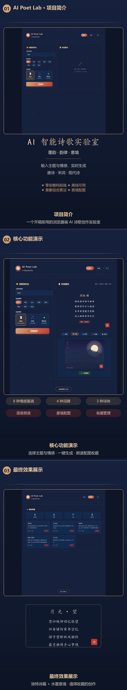

# AI Poet Lab · AI 智能诗歌实验室

> 输入主题与情感，一键生成唐诗、宋词与现代诗，并自动绘制水墨意境配图。
> 纯前端实现，零依赖，开箱即用，离线可用。



---

## 📖 项目背景

AI 正在重塑内容创作方式，但「让 AI 写一首好诗」这件事仍有两个痛点：

1. **依赖云端 API** — 需要密钥、有网络延迟、有调用成本，离线即不可用；
2. **生成不可控** — 大模型输出随机性大，很难保证格律、意象与情感的对应关系。

**AI Poet Lab** 探索了另一条路径：**用规则引擎做诗**。

项目内置了一套「意象组合 + 韵律约束」的诗歌生成算法：把汉字拆解为**意象词**（自然景物 / 人文意象 / 情感动词）三类，按情感基调分组建立意象库；再用**句式模板**将意象编排为符合唐诗绝句、宋词长短句、现代自由诗三种格律的句子。整个过程完全在浏览器本地完成，无需任何后端服务。

结果是一台**离线可用、零成本、零延迟、且每次输出都不重复**的诗歌生成器。

---

## ✨ 功能介绍

### 🎭 三种诗体

| 诗体 | 格律 | 说明 |
|------|------|------|
| **唐诗** | 五言绝句 / 七言绝句 | 随机选用，严格 4 句、字数统一 |
| **宋词** | 如梦令 / 长相思 / 相见欢 / 忆江南 | 4 种经典词牌，各自对应的长短句格式 |
| **现代诗** | 自由体 | 多行新诗体，节奏自由 |

### 🌈 八种情感基调

`思乡` `离别` `壮志` `爱情` `田园` `咏物` `感怀` `豪放`

每种情感对应**独立的意象库**。选择「离别」时，生成器只会调用柳岸、孤帆、离歌、别酒、征鞍、依依这一组意象；选择「咏物」则调用青竹、寒梅、幽兰、傲骨、清韵、冰心…… 情感与意象严格对应，不会出现「离别」配「稻田」的违和。

### 🔊 诗歌朗读

基于浏览器原生 **Web Speech API**，自动优先选用中文语音（`zh-CN`），语速 0.7、音调 0.8，附实时进度条与停止按钮。

### 🖼️ 意境配图

基于 **Canvas API** 实时绘制水墨风格意境画。根据情感自动匹配场景：

| 情感 | 意境场景 |
|------|----------|
| 思乡 | 月晕 + 远山层叠 |
| 离别 | 日落 + 江波 + 孤舟 |
| 壮志 | 星空 + 雪山峰峦 |
| 爱情 | 落英缤纷 + 月华 |
| 田园 | 稻田 + 炊烟 + 远山 |
| 咏物 | 竹竿 + 竹节 + 叶片 |
| 感怀 | 流云 + 暮色 |
| 豪放 | 怒涛 + 星海 |

配图包含竖排水印标题、风格标签与朱红印章，可一键下载 PNG。

### ⭐ 收藏管理

基于 `localStorage` 的本地持久化收藏，支持按唐诗 / 宋词 / 现代诗分类统计、单条删除，无任何服务端依赖。

### 🎨 水墨中国风界面

- 暗蓝夜空 + 金墨 + 朱红印章的配色体系
- Canvas 粒子系统背景，含**鼠标引力交互**与粒子连线
- 诗歌逐句渐显动画 + 朱红印章落款
- 完整响应式适配（桌面 / 平板 / 手机）

---

## 🚀 安装与运行

### 环境要求

- 现代浏览器（Chrome 90+ / Edge 90+ / Firefox 88+ / Safari 14+）
- **无需** Node.js、Python、数据库或任何构建工具

### 方式一：直接打开（最简单）

双击 `index.html` 即可使用。

### 方式二：本地静态服务器（推荐）

```bash
# Node.js
npx serve .
# 或
npx http-server -p 8080

# Python
python -m http.server 8080
```

然后访问 `http://localhost:8080`。

### 方式三：VS Code

安装 **Live Server** 扩展，右键 `index.html` → *Open with Live Server*。

### 重新生成介绍图文（可选）

图文合成脚本依赖 `sharp`，仅在需要重新生成时安装：

```bash
npm install sharp
node scripts/make-intro.js
```

---

## 📁 项目结构

```
ai-poet-lab/
├── index.html                  # 主页面（创作 / 收藏 / 关于 三视图）
├── favicon.svg                 # 站点图标
├── css/
│   └── style.css               # 水墨中国风样式 + 响应式
├── js/
│   ├── poem-engine.js          # ★ 诗歌生成引擎（意象库 / 韵脚库 / 句式模板）
│   ├── image-generator.js      # Canvas 意境配图生成器（8 种场景）
│   └── app.js                  # 主应用逻辑（交互 / 朗读 / 收藏 / 背景动画）
├── scripts/
│   └── make-intro.js           # 介绍图文合成脚本（sharp）
├── assets/
│   ├── intro-9x16.png          # 9:16 竖屏介绍图文（1080×5808）
│   ├── intro-1-project.png     # 画面一：项目简介
│   ├── intro-2-features.png    # 画面二：核心功能演示
│   ├── intro-3-result.png      # 画面三：最终效果展示
│   └── shot-*.png              # 素材截图
├── PROJECT_INFO.md             # AI 可读项目说明文档
└── README.md
```

---

## 🏗️ 实现要点

### 意象组合算法

```js
// 每个情感有独立的 natural / human / emotion 三类意象库
imagery: {
  离别: {
    natural: ['柳岸', '斜阳', '残月', '烟波', '孤帆', '落花', ...],
    human:   ['长亭', '古道', '离歌', '别酒', '行舟', '远客', ...],
    emotion: ['相送', '执手', '回首', '挥手', '相看', '依依', ...]
  }
}

// 句式模板 + 意象填充
'{natural}生{human}，{emotion}{natural}。{human}{emotion}，{natural}{emotion}。'
```

生成时通过 `Set` 追踪已用过的意象，配合最多 10 次重试，避免同一首诗中意象重复。

### 宋词词牌结构

```js
'长相思': {
  lines: [3, 3, 5, 5, 3, 3, 5, 5],   // 每句字数
  template: '{natural}，{natural}，{emotion}{human}{natural}，{emotion}{natural}{human}。...'
}
```

### 韵脚库

按传统韵部分组（`ang` / `ing` / `an` / `ou` / `i` / `u` / `e` / `ao`），每组包含大量同韵字，供后续扩展押韵校验使用。

---

## ✅ 运行验证

本项目已完成以下验证：

| 验证项 | 结果 |
|--------|------|
| 页面加载（HTTP 200） | ✅ 通过 |
| 控制台错误 | ✅ 无（仅 favicon 已补齐） |
| 唐诗生成 | ✅ 五言/七言绝句格式正确 |
| 宋词生成 | ✅ 4 种词牌均可用 |
| 现代诗生成 | ✅ 多行体裁正常 |
| 意境配图生成 | ✅ 8 种情感场景均正常 |
| 朗读功能 | ✅ Web Speech API 正常触发 |
| 收藏持久化 | ✅ localStorage 读写正常 |
| 收藏统计与删除 | ✅ 分类计数正确 |
| 200 首批量生成 | ✅ 0 错误，200 首全部唯一 |
| 移动端 414×896 | ✅ 无横向溢出，功能完整 |

---

## 🛠️ 技术栈

| 层面 | 技术 |
|------|------|
| 结构 | HTML5 |
| 样式 | CSS3（自定义属性、Grid、Flex、backdrop-filter） |
| 逻辑 | 原生 JavaScript（ES6+） |
| 朗读 | Web Speech API |
| 绘图 | Canvas 2D API |
| 存储 | localStorage |
| 图文合成 | Node.js + sharp（仅构建期使用） |

**运行时零依赖**——`index.html` + 3 个 JS 文件 + 1 个 CSS 文件即可完整运行。

---

## 📄 许可证

MIT License

---

## 🤝 贡献

欢迎提交 Issue 与 Pull Request。扩展方向包括：

- 增加更多词牌与诗体（如律诗、楚辞体）
- 基于韵脚库实现严格押韵校验
- 增加藏头诗、藏尾诗、指定字数等模式
- 导出为图片 / PDF / 语音文件
- 接入真实大模型 API 作为「增强模式」

---

**如果这个项目对你有帮助，欢迎给一个 ⭐ Star！**
